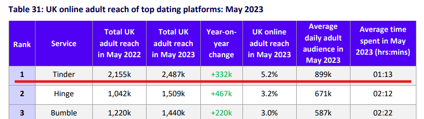
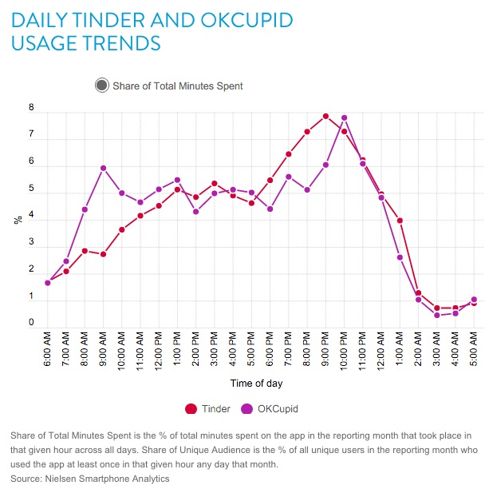

# Проектирование высоконагруженного dating-сервиса

## 1. Тема и целевая аудитория

### 1.1. Тема

Dating-приложение для пользователей EU-27.

Основной проектируемый контур:

**Discovery → Like/Pass → Match**.

Аналоги: Tinder, Bumble, Hinge.

### 1.2. Целевая аудитория

| Параметр | Значение |
|---|---|
| Регион | EU-27 |
| Население региона | ~450,4 млн [1] |
| Возраст | 18–39 лет |
| Аудитория аналога | 10 млн еженедельно активных пользователей Tinder в Европе [2] |

EU-27 выбран как единый регион: большая часть аудитории находится в близких часовых поясах, поэтому регион удобен для дальнейшего анализа суточного профиля нагрузки.

### 1.3. Функционал MVP

1. **Профиль и предпочтения**
   - фотографии и основная информация;
   - пол и предпочтения;
   - возрастной диапазон;
   - максимальная дистанция поиска.

2. **Обновление местоположения**
   - хранение актуальной геопозиции пользователя;
   - использование геопозиции при подборе кандидатов.

3. **Discovery**
   - формирование персонализированной ленты анкет;
   - фильтрация по расстоянию, возрасту и предпочтениям;
   - исключение уже просмотренных анкет;
   - ранжирование кандидатов.

4. **Like / Pass**
   - сохранение реакции пользователя на анкету.
   - отправка уведомления пользователю при получении Like.

5. **Match**
   - автоматическое создание Match при взаимном Like;
   - не более одного Match для одной пары пользователей.
   - отправка уведомления пользователю при создании Match.

6. **Список Match**
   - получение списка взаимных совпадений пользователя.

### 1.4. Ключевые продуктовые решения

- Discovery формируется сервером, пользователь не выполняет произвольный поиск по базе анкет.
- География, возраст и предпочтения используются при отборе кандидатов [3].
- Уже обработанные через Like/Pass анкеты повторно в обычной ленте не показываются.
- Match создаётся только при взаимном Like [4].
- Точная геопозиция пользователя другим пользователям не раскрывается.
- Ранжирование выполняется на сервере; ML-модель не является обязательной частью MVP.
- Чат, платежи, звонки и рекламная система не входят в MVP.

## 2. Расчет нагрузки

В разделе рассчитываются продуктовые и технические метрики для основного контура сервиса **Discovery → Like/Pass → Match**.

### 2.1. Аудитория

В качестве верхней оценки месячной аудитории используется официальное раскрытие Tinder по требованиям DSA: за период с 1 июля по 31 декабря 2025 года среднемесячное количество активных получателей Tinder в ЕС было **менее 15 млн** [5]. Для проектирования принимается верхняя граница:

`MAU = 15 млн пользователей`.

Публичного актуального DAU для всего ЕС Tinder не раскрывает. Для оценки отношения `DAU / MAU` используются данные Ofcom / Ipsos iris по Великобритании за май 2023 года: месячная аудитория Tinder составила 2,487 млн пользователей, средняя дневная аудитория — 899 тыс. [6].

`DAU / MAU = 899 000 / 2 487 000 ≈ 0,361 = 36,1%`

`DAU = 15 000 000 × 0,361 = 5 415 000`

Таким образом, для дальнейших расчётов принимается:

| Метрика | Значение |
|---|---:|
| MAU | 15 млн |
| DAU | 5,415 млн |
| DAU / MAU | 36,1% |

Перенос коэффициента `36,1%` с Великобритании на EU-27 является расчётной экстраполяцией.

### 2.2. Продуктовые метрики

#### 2.2.1. Like / Pass

Под Like/Pass понимается суммарное количество положительных и отрицательных реакций на показанные анкеты.

По внутренним данным Tinder, в 2024 году пользователи отправляли почти **16 млрд Likes/Pass в неделю** [7]. Tinder также указывает аудиторию около **50 млн пользователей в месяц** по всему миру [8].

Среднее количество реакций на одного пользователя месячной аудитории в сутки:

`16 000 000 000 / 7 / 50 000 000 ≈ 45,7 Like/Pass`

Для проектируемого сервиса:

`15 000 000 × 45,7 ≈ 685,7 млн Like/Pass в сутки`

В пересчёте на одного DAU:

`685,7 млн / 5,415 млн ≈ 126,6 Like/Pass на активного пользователя в сутки`

#### 2.2.2. Использования приложения

По данным Nielsen Digital Japan за апрель 2025 года, Tinder использовался в среднем **52 раза в месяц на пользователя** [9].

Для расчётного месяца в 30 дней:

`52 / 30 ≈ 1,73 использования приложения на MAU в сутки`

или:

`1,73 / 0,361 ≈ 4,8 использования на DAU в активный день`

Для операций, выполняемых при каждом новом использовании приложения, в проекте принимается правило: клиент один раз обновляет актуальную геопозицию и один раз синхронизирует первую страницу списка Match.

#### 2.2.3. Discovery

В открытой реализации Tinder API, восстановленной по реальным XHR-запросам клиента, метод получения рекомендаций возвращал от 0 до 25 потенциальных анкет [14]. Поэтому для проектируемого сервиса принимается размер одной пачки Discovery:

`25 анкет / запрос`.

Клиент сохраняет неиспользованные анкеты локально и запрашивает следующую пачку только после исчерпания текущей. Тогда в долгосрочном среднем:

`685,7 млн / 25 ≈ 27,43 млн Discovery-запросов в сутки`

На одного пользователя MAU:

`45,7 / 25 ≈ 1,83 Discovery-запроса в сутки`

#### 2.2.4. Match

Для оценки частоты Match используются более свежие внутренние данные Tinder за 2024 год. Tinder указывает, что на Dating Sunday создавалось около **380 Match в секунду**, что примерно на 9% выше обычного уровня года [16]. Следовательно, обычный уровень:

`380 / 1,09 ≈ 348,6 Match/с`

`348,6 × 86 400 ≈ 30,12 млн Match/сутки`

С учётом почти 16 млрд Like/Nope в неделю [7]:

`30,12 млн / (16 млрд / 7) ≈ 1,318%`

Для проектируемого сервиса:

`685,7 млн × 1,318% ≈ 9,04 млн новых Match/сутки`

Одна физическая запись Match относится к одной паре пользователей. В среднем это:

`9,04 млн / 15 млн ≈ 0,602 создаваемого Match на MAU в сутки`

Поскольку один Match появляется в списках двух пользователей:

`2 × 0,602 ≈ 1,205 нового элемента Match List на пользователя в сутки`

#### 2.2.5. Сводная таблица продуктовых метрик

| Метрика | Значение |
|---|---:|
| MAU | 15 млн |
| DAU | 5,415 млн |
| Like/Pass на MAU в сутки | ≈45,7 |
| Like/Pass на DAU в сутки | ≈126,6 |
| Like/Pass всего в сутки | ≈685,7 млн |
| Использований приложения на MAU в сутки | ≈1,73 |
| Discovery-запросов на MAU в сутки | ≈1,83 |
| Location Update на MAU в сутки | ≈1,73 |
| Match List на MAU в сутки | ≈1,73 |
| Создаваемых Match на MAU в сутки | ≈0,602 |
| Новых элементов Match List на пользователя в сутки | ≈1,205 |

### 2.3. Средний размер хранилища пользователя

#### 2.3.1. Фотографии

В исследовании 307 Tinder-профилей пользователей 18–30 лет из Бельгии среднее количество фотографий в профиле составило **4,79** [10]. Это значение принимается как среднее количество фотографий на пользователя.

В открытом дампе Tinder API для одной пользовательской фотографии присутствуют original-файл и четыре обработанных WebP-варианта:

- `640×800`;
- `320×400`;
- `172×216`;
- `84×106`;

для WebP указан `quality factor = 75` [11].

Для проектируемого сервиса принимается аналогичная модель хранения. После preprocessing original/canonical JPEG ограничивается **2 МБ**. Это проектное ограничение обосновывается практикой хранения изображений в других массовых сервисах: например, схема Bluesky для raw image blob устанавливает максимальный размер 2 МБ [12].

Для оценки четырёх WebP-копий используется исследование Google WebP: для фотографических наборов Kodak и Tecnick при качестве, соответствующем JPEG Q=75, средняя плотность находится примерно на уровне 0,51–0,63 бит/пиксель [13]. Чтобы не занижать объём, в capacity planning принимается консервативный бюджет **1 бит/пиксель**.

Общее количество пикселей четырёх вариантов:

`640×800 + 320×400 + 172×216 + 84×106 = 686 056 пикселей`

При 1 бит/пиксель:

`686 056 / 8 ≈ 85,8 КБ`

После округления с запасом принимается:

`≈0,10 МБ на все четыре WebP-варианта`

Полный storage budget одной фотографии:

`2,00 + 0,10 = 2,10 МБ`

Средний пользователь:

`4,79 × 2,10 ≈ 10,06 МБ = 0,01006 ГБ`

При этом одна логическая фотография представлена пятью физическими объектами, поэтому:

`4,79 × 5 ≈ 23,95 image objects на пользователя`

#### 2.3.2. Like / Pass

Для Like/Pass принимается rolling retention **12 месяцев**: система хранит только реакции за последний год. Это ограничивает неограниченный рост истории реакций. Для пользователя такой срок не должен быть существенной проблемой: спустя год ранее просмотренная анкета уже может заметно измениться, а сам факт её прежнего просмотра с высокой вероятностью будет забыт. После удаления старой реакции анкета снова может попасть в Discovery.

Среднее число реакций на одного пользователя за 12 месяцев:

`45,7 × 365 ≈ 16 686 записей`

Логическая запись реакции содержит:

| Поле | Размер |
|---|---:|
| `user_id` | 8 Б |
| `target_user_id` | 8 Б |
| `reaction` | 1 Б |
| `created_at` | 8 Б |
| **Итого** | **25 Б** |

Средний логический объём Like/Pass на пользователя:

`16 686 × 25 ≈ 417 150 Б ≈ 0,000417 ГБ`

#### 2.3.3. Match

Match хранится бессрочно, поскольку является пользовательским состоянием. Для одной пары достаточно двух идентификаторов пользователей и времени создания:

| Поле | Размер |
|---|---:|
| `user_a_id` | 8 Б |
| `user_b_id` | 8 Б |
| `created_at` | 8 Б |
| **Итого** | **24 Б** |

За первый год создаётся:

`9,04 млн × 365 ≈ 3,30 млрд Match`

На одного пользователя приходится около 440 элементов Match List за год, но одна физическая запись хранится только один раз на пару. В пересчёте на долю физического storage это около **5,3 КБ на пользователя за год**.

#### 2.3.4. Сводная таблица хранения на пользователя

| Тип данных | Количество на пользователя | Объём на пользователя |
|---|---:|---:|
| Фотографии | 4,79 фото / ≈23,95 image objects | ≈0,01006 ГБ |
| Like/Pass за последние 12 мес. | ≈16 686 записей | ≈0,000417 ГБ |
| Match, первый год | ≈440 элементов в списке | ≈0,0000053 ГБ |
| **Итого** | — | **≈0,01048 ГБ** |

Профиль, предпочтения и текущая геопозиция занимают на порядки меньше места по сравнению с фотографиями и историей реакций.

### 2.4. Общий размер хранилища

Для расчёта продуктового хранилища принимается 15 млн хранимых активных профилей. Архивирование удалённых и длительно неактивных аккаунтов находится за рамками MVP.

Фотографии:

`15 млн × 4,79 = 71,85 млн логических фотографий`

`71,85 млн × 5 = 359,25 млн image objects`

`71,85 млн × 2,10 МБ ≈ 150,89 ТБ`

Like/Pass:

`685,7 млн × 365 ≈ 250,29 млрд записей`

`250,29 млрд × 25 Б ≈ 6,26 ТБ`

Match за первый год:

`≈3,30 млрд × 24 Б ≈ 0,079 ТБ`

| Тип данных | Количество | Объём |
|---|---:|---:|
| Фотографии | 71,85 млн фото / 359,25 млн объектов | ≈150,89 ТБ |
| Like/Pass, rolling window 12 мес. | ≈250,29 млрд записей | ≈6,26 ТБ |
| Match, первый год | ≈3,30 млрд записей | ≈0,079 ТБ |
| **Итого** | — | **≈157,23 ТБ** |

При стабильной аудитории объём фотографий и Like/Pass выходит на стационарный уровень. Match хранится бессрочно и добавляет примерно `0,079 ТБ/год`.

### 2.5. Суточный профиль и коэффициент пиковой нагрузки

Для оценки обычного суточного пика используется опубликованный MarketingProfs график на основе **Nielsen Electronic Mobile Measurement**. Nielsen измерял использование приложений пассивным мониторингом смартфонов пользователей в США. Для Tinder максимум приходится на вечернее время; час 22:00–23:00 является пиковым [15].

*Рисунок — суточный профиль использования Tinder и OkCupid по данным Nielsen Smartphone Analytics [15].*

По графику на пиковый час Tinder приходится примерно **7,7%** суточного времени использования. Среднее значение для одного часа:

`100% / 24 ≈ 4,167%`

Коэффициент пикового часа:

`K_peak = 7,7 / 4,167 ≈ 1,85`

Современные внутренние данные Tinder дополнительно подтверждают вечерний характер пика: наиболее загруженные часы приходятся примерно на 21:00–22:00 local time [17].

Для расчётов принимается:

`K_peak = 1,85`

### 2.6. RPS

#### 2.6.1. Like / Pass

`685,7 млн / 86 400 ≈ 7 937 RPS`

Пик:

`7 937 × 1,85 ≈ 14 683 RPS`

#### 2.6.2. Discovery

`27,43 млн / 86 400 ≈ 317 RPS`

Пик:

`317 × 1,85 ≈ 587 RPS`

#### 2.6.3. Location Update

При каждом использовании приложения выполняется одно обновление геопозиции.

`15 млн × 52 / 30 = 26 млн запросов/сутки`

`26 млн / 86 400 ≈ 301 RPS`

Пик:

`301 × 1,85 ≈ 557 RPS`

#### 2.6.4. Match List

При каждом использовании приложения клиент один раз синхронизирует актуальный список Match:

`26 млн запросов/сутки`

`≈301 RPS average`

`≈557 RPS peak`

#### 2.6.5. Match creation

Создание Match не является отдельным внешним HTTP-запросом: оно выполняется внутри обработки Like при обнаружении встречного Like.

`9,04 млн / 86 400 ≈ 105 событий/с`

Пик:

`105 × 1,85 ≈ 193 события/с`

Эта нагрузка учитывается как внутренняя и не прибавляется повторно к внешнему API RPS.

#### 2.6.6. Сводная таблица RPS

| Метод | Запросов/сутки | Средний RPS | Пиковый RPS |
|---|---:|---:|---:|
| Like / Pass | ≈685,7 млн | ≈7 937 | ≈14 683 |
| Discovery | ≈27,43 млн | ≈317 | ≈587 |
| Location Update | 26 млн | ≈301 | ≈557 |
| Match List | 26 млн | ≈301 | ≈557 |
| **Итого внешний API** | **≈765,1 млн** | **≈8 856** | **≈16 384** |
| Match creation, внутренняя операция | ≈9,04 млн | ≈105 | ≈193 |

Редкие операции редактирования профиля в итоговую highload-таблицу не включаются: их частота на порядки ниже основного контура и публичной репрезентативной метрики для них нет.

### 2.7. Сетевой трафик

В отчёте data.ai *State of Mobile 2022* для Tinder указано около **190 МБ мобильного трафика на активного пользователя в месяц** в 2021 году; данные относятся к Android [18].

Для нашей аудитории:

`15 млн × 190 МБ / 30 ≈ 95 000 ГБ/сутки`

То есть:

`≈95 ТБ/сутки`

Средняя пропускная способность:

`95 000 × 8 / 86 400 ≈ 8,80 Гбит/с`

Пиковая:

`8,80 × 1,85 ≈ 16,27 Гбит/с`

Значение 190 МБ/месяц дополнительно проверяется более свежими источниками. Ofcom сообщает, что в мае 2024 года средний посетитель Tinder в Великобритании провёл в сервисе около **1 часа 3 минут** [19]. В тестах Sim Local 2025 года десять минут свайпинга в Tinder потребляли 29,7–49,5 МБ [20]. Эти измерения дают сопоставимый порядок месячного трафика.

#### 2.7.1. Разбивка media-трафика

Для основного экрана Discovery обязательно загружается как минимум первая фотография каждой обработанной анкеты. Для WebP-варианта `640×800` при принятом консервативном бюджете 1 бит/пиксель:

`640 × 800 / 8 = 64 000 Б ≈ 64 КБ`

Тогда минимальный трафик первых фотографий:

`685,7 млн × 64 КБ ≈ 43 886 ГБ/сутки`

Средняя пропускная способность:

`≈4,06 Гбит/с`

Пиковая:

`≈7,52 Гбит/с`

Оставшаяся часть общего traffic budget включает дополнительные фотографии профилей, JSON/metadata Discovery, Like/Pass, Location, Match List, HTTP/TLS overhead и прочий небольшой трафик:

`95 000 - 43 886 ≈ 51 114 ГБ/сутки`

| Тип трафика | ГБ/сутки | Средний Гбит/с | Пиковый Гбит/с |
|---|---:|---:|---:|
| Первые фото Discovery | ≈43 886 | ≈4,06 | ≈7,52 |
| Дополнительные фото + API/metadata + protocol overhead | ≈51 114 | ≈4,73 | ≈8,76 |
| **Итого** | **≈95 000** | **≈8,80** | **≈16,27** |

Полученная разбивка показывает, что фотографии являются существенным источником сетевой нагрузки.

---

## Источники

1. Eurostat. *EU population increases for the 4th consecutive year*, 11.07.2025.  
   https://ec.europa.eu/eurostat/web/products-eurostat-news/w/ddn-20250711-1

2. Sensor Tower. *Top 5 Dating Apps in Europe Q3 2025: Performance Insights*, 2025.  
   https://sensortower.com/blog/2025-q3-unified-top-5-dating-revenue-europe-64c9b6bbe1714cfff1c9d0e8

3. Tinder Help. *Discovery Settings*.  
   https://www.help.tinder.com/hc/en-us/articles/115003340963-Discovery-Settings

4. Tinder. *Frequently Asked Questions — How do Tinder matches work?*  
   https://tinder.com/faq

5. Tinder. *Regulatory disclosures — European Digital Services Act: Average Monthly Active Recipients*.  
   https://policies.tinder.com/community/additional-information/disclosures/intl/en/?utm_source=chatgpt.com
   
6. Ofcom. *Online Nation 2023 Report*, 2023.  
   https://www.ofcom.org.uk/siteassets/resources/documents/research-and-data/online-research/online-nation/2023/online-nation-2023-report.pdf

7. Tinder. *Tinder Launches “Crush Feelings” Campaign, Celebrating the Euphoric Rush of Having a Crush*, 25.08.2025.  
   https://www.tinderpressroom.com/2025-08-25-Tinder-Launches-Crush-Feelings-Campaign-Celebrating-the-Euphoric-Rush-of-Having-a-Crush

8. Tinder. *About Tinder*.  
   https://www.tinderpressroom.com/about

9. Nielsen Digital. *恋愛・結婚マッチングサービスの利用状況*, 03.07.2025.  
   https://www.netratings.co.jp/news_release/2025/07/Newsrelease20250703.html

10. Vranken I., Sumter S., Vandenbosch L. *A Multi-Method Study Examining the Role of Swiping on Dating Apps: Mate Value Preferences, Sexual Satisfaction, and Need Satisfaction with Matches in Emerging Adults*, Archives of Sexual Behavior, 2024.  
    https://pure.uva.nl/ws/files/186308271/A_Multi-Method_Study_Examining_the_Role_of_Swiping_on_Dating_Apps.pdf

11. Tinder API response dump. GitHub Gist, 2020.  
    https://gist.github.com/tinder-stevewang/53f1eeb875651d5e6189e3e352d2f6c8

12. Bluesky / AT Protocol. `app.bsky.embed.images` schema.  
    https://github.com/bluesky-social/atproto/blob/main/lexicons/app/bsky/embed/images.json

13. Google for Developers. *WebP Compression Study*.  
    https://developers.google.com/speed/webp/docs/webp_study

14. Henshall. *php-tinder-api — Get Recommendations*. GitHub.  
    https://github.com/Henshall/php-tinder-api

15. MarketingProfs / Nielsen. *The Most Popular Times for Using Chat and Dating Apps*, 2016.  
    https://www.marketingprofs.com/charts/2016/29325/the-most-popular-times-for-using-chat-and-dating-apps

16. Tinder. *Dating Sunday Data*, internal Tinder data comparing 7 January 2024 with yearly averages.  
    https://au.tinderpressroom.com/Tinder-Dating-Sunday-Data-1-1-26

17. Tinder. *Tinder Reveals That Romance is Far From Dead on Valentine's Day*, 2024.  
    https://in.tinderpressroom.com/2024-02-08-Tinder-Reveals-That-Romance-is-Far-From-Dead

18. data.ai. *State of Mobile 2022*.  
    https://www.communicationstoday.co.in/wp-content/uploads/2024/01/india__dataai__state_of_mobile_2022__en.pdf

19. Ofcom. *Online Nation 2024 Report*, 2024.  
    https://www.ofcom.org.uk/siteassets/resources/documents/research-and-data/online-research/online-nation/2024/online-nation-2024-report.pdf

20. Sim Local. *How Much Data Does Tinder and Bumble Use?*, 05.02.2025.  
    https://www.simlocal.com/post/how-much-data-does-bumble-tinder-use
    